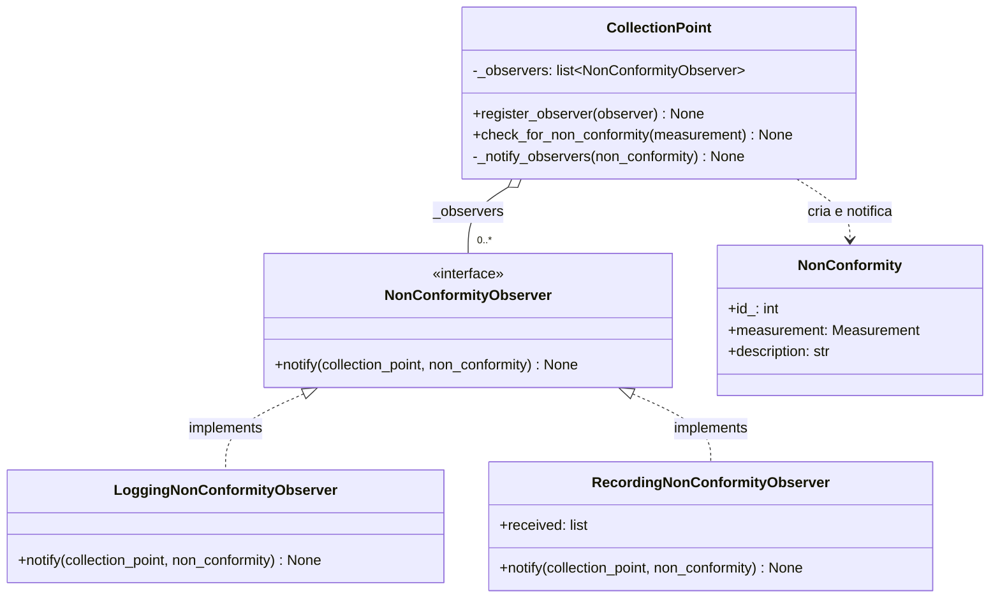
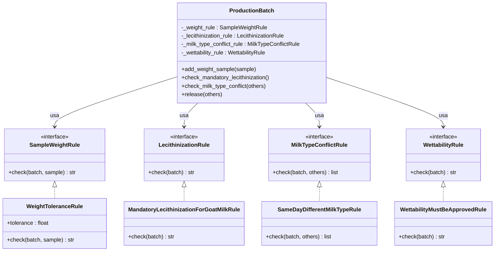
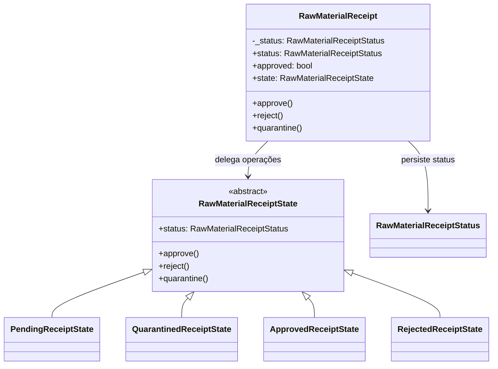
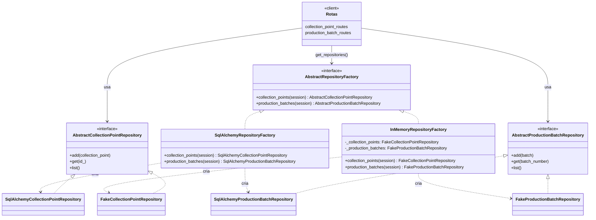

# Checkpoint 3 — Padrões GoF

**Disciplina:** Projeto de Software — UFF 2026.2
**Checkpoint:** 3 · Padrões GoF (10/11)
**Equipe:** Lucas Ardelino Alves da Silva, João Gabriel Pimentel, Aloysio Felipe Saad Silva, André Meschesi Dantas

Cada integrante implementa pelo menos um padrão GoF no seu agregado/módulo, introduzido
na Fase 2 (commits do próprio autor a partir de 06/10), resolvendo um problema real do
domínio — não um padrão que o framework já implementa. Os padrões são diferentes entre
si dentro do grupo.

| Integrante | Agregado/módulo | Padrão | Categoria | Status |
|---|---|---|---|---|
| João Gabriel Pimentel | `CollectionPoint` (domínio) | Observer | Comportamental | ✅ Concluído |
| Aloysio Felipe Saad Silva | `ProductionBatch` (domínio) | Strategy | Comportamental | ✅ Concluído |
| Lucas Ardelino Alves da Silva | `RawMaterialReceipt` (domínio) | State | Comportamental | ✅ Concluído |
| André Meschesi Dantas | Infraestrutura e API (`repository.py` + rotas) | Abstract Factory | Criacional | ✅ Concluído |

---

## João Gabriel Pimentel — Observer no agregado `CollectionPoint`

### Nome e categoria

**Observer** — padrão **comportamental**.

### Contexto no sistema e problema que ele resolve

`CollectionPoint.check_for_non_conformity` é o único lugar do sistema onde uma
`NonConformity` nasce (CQ-03 em `docs/arquitetura.md`: não existe repositório de
`NonConformity`, só a Aggregate Root escreve). Até este checkpoint, esse método
só fazia uma coisa com a não conformidade recém-criada: `self.non_conformities.append(...)`.
Nada fora do agregado era avisado.

Isso é uma lacuna real, já identificada antes deste checkpoint:

- `docs/arquitetura.md` §5.1 (alternativa C) registra explicitamente que "há um
  ponto onde eventos caberiam bem: a notificação de não conformidade para fora
  do agregado", deixado como caminho para a Fase 2.
- O stakeholder "Supervisor de produção" (§1 do mesmo documento) precisa saber
  quando algo sai da faixa — hoje só fica sabendo se consultar `GET
  /non-conformities` manualmente.

O problema de projeto, então, é: **como o `CollectionPoint` avisa um número
variável e crescente de interessados (log, auditoria, e-mail, fila de eventos)
sem conhecer nenhum deles e sem precisar ser alterado a cada novo
interessado?** Resolver isso com `if`/`else` dentro de
`check_for_non_conformity` reabriria a mesma violação de OCP corrigida no
Checkpoint 2 (`docs/solid.md`): a cada canal de notificação novo, o método do
agregado mudaria de novo.

### Por que esse padrão

**Observer** foi escolhido porque o problema é exatamente "um estado muda, N
partes precisam ser avisadas, e o número de partes varia com o tempo" — a
definição do padrão. O `CollectionPoint` (Subject) só depende de uma interface
(`NonConformityObserver`), nunca de um observador concreto.

Alternativas consideradas:

| Alternativa | Por que foi descartada |
|---|---|
| **Chamada direta no domínio** (ex.: `logging.warning(...)` dentro de `check_for_non_conformity`) | Acopla o domínio a um canal de notificação específico e viola CQ-01 (`domain/` não pode saber como o mundo externo é avisado) e reabre a violação de OCP do Checkpoint 2: um segundo canal (e-mail) exigiria editar `CollectionPoint` de novo. |
| **Lista de callables genéricos** (`list[Callable[[CollectionPoint, NonConformity], None]]`) em vez de uma interface | Resolveria o acoplamento, mas perde o contrato explícito que o projeto já usa para abstrações de borda (`AbstractCollectionPointRepository`, ADR-0002); uma interface nomeada (`NonConformityObserver`) deixa o papel de quem implementa óbvio e documentado, e é consistente com o estilo do resto do código. |
| **Arquitetura orientada a eventos entre agregados** (fila/barramento de eventos) | É a opção da Fase 2 "de verdade", mas tem custo de infraestrutura (fila, consistência eventual) que o projeto rejeitou em §5.1 para decisões não síncronas desse porte. Observer é o primeiro passo *dentro* do próprio processo — o mesmo ponto de extensão onde um publicador de eventos entraria depois. |

### Participantes mapeados para classes reais

| Papel no padrão | Classe real | Arquivo |
|---|---|---|
| **Observer** (interface) | `NonConformityObserver` | `src/LactoQC/domain/model.py` |
| **Subject / ConcreteSubject** | `CollectionPoint` | `src/LactoQC/domain/model.py` |
| **ConcreteObserver** (produção) | `LoggingNonConformityObserver` | `src/LactoQC/service_layer/notifications.py` |
| **ConcreteObserver** (teste) | `RecordingNonConformityObserver` | `tests/unit/test_collection_point.py` |
| Evento observado | `NonConformity` | `src/LactoQC/domain/model.py` |

`CollectionPoint.register_observer(observer)` anexa um `NonConformityObserver`
à lista interna `_observers`; `check_for_non_conformity` chama
`self._notify_observers(non_conformity)` logo após criar a não conformidade.
A rota `register_measurement` (`collection_point_routes.py`) e o caso de uso
`services.register_measurement` são quem registra o `LoggingNonConformityObserver`
no agregado antes de processar a medição — o Subject nunca instancia seu
próprio Observer.

### Diagrama de classes



### Teste que exercita o padrão

`tests/unit/test_collection_point.py`:

```python
def test_observer_is_notified_when_non_conformity_is_created():
    collection_point = make_collection_point()
    observer = RecordingNonConformityObserver()
    collection_point.register_observer(observer)

    day = date(2026, 9, 29)
    collection_point.add_measurement(make_measurement(1, MeasurementType.PH, day, 8.0))

    assert len(observer.received) == 1
    notified_point, notified_nc = observer.received[0]
    assert notified_point is collection_point
    assert notified_nc is collection_point.non_conformities[0]
```

Complementado por `test_observer_is_not_notified_when_measurement_is_within_specification`
(observer não é chamado quando não há não conformidade),
`test_multiple_observers_are_all_notified` (N observers independentes) e
`test_collection_point_without_observers_behaves_as_before` (regressão: sem
observers, o comportamento é idêntico ao de antes do padrão). No nível de
serviço, `tests/unit/test_collection_point_services.py::test_register_measurement_notifies_observers_of_new_non_conformities`
prova que o `observers` passado para `services.register_measurement` chega
de fato até o Subject.

Suíte completa depois da mudança: `180 passed` (era `174` antes deste
checkpoint — 6 testes novos, nenhum teste existente mudou de comportamento).

### Custo da aplicação do padrão

**Custo:** uma interface nova (`NonConformityObserver`), um módulo novo
(`service_layer/notifications.py`), dois métodos a mais em `CollectionPoint`
(`register_observer`, `_notify_observers`) e um parâmetro opcional
(`observers`) propagado por `services.register_measurement` e pela rota. É
indireção genuína: para saber o que acontece com uma não conformidade, agora
é preciso olhar em três arquivos em vez de um.

Há também um detalhe de borda que o padrão herdou do R-02 de
`docs/arquitetura.md` (SQLAlchemy não chama `__init__` ao carregar do banco):
`_observers` pode não existir em uma instância recarregada, por isso
`register_observer`/`_notify_observers` usam `getattr(self, "_observers", [])`
em vez de assumir que o atributo já existe. É um custo pequeno, mas que só
apareceu por causa do padrão.

**Por que compensa:** o canal de notificação atual (log) é deliberadamente o
mais simples possível — o ganho real é que adicionar um segundo canal (e-mail
ao supervisor, publicar em uma fila de eventos na Fase 2) é **uma classe nova
que implementa `NonConformityObserver` e uma linha em
`_non_conformity_observers`**, em `collection_point_routes.py`. Nenhuma
mudança em `CollectionPoint`, em `services.py` além da assinatura já pronta,
ou nos testes existentes. É exatamente o requisito que `docs/arquitetura.md`
§5.1 deixou em aberto, resolvido com o menor acoplamento possível.


## Aloysio Felipe Saad Silva — `ProductionBatch` (agregado Lote de Produção)

### Padrão GoF aplicado: Strategy (comportamental)

**Commit de implementação das classes do padrão:** [`6140ef5`](../../commit/6140ef5) (mesmo commit da refatoração SOLID — as classes Strategy nasceram ali). **Commit dos testes dedicados ao padrão e desta documentação:** [`40e24a8`](../../commit/40e24a8).

### Por que Strategy

As quatro regras de qualidade do Lote de Produção — tolerância de peso,
lecitinização obrigatória para leite de cabra, conflito de tipo de leite no
mesmo dia e aprovação da molhabilidade — são, cada uma, **um algoritmo de
decisão independente**: recebem o estado do lote (e, em dois casos, um dado
extra) e devolvem "passou" ou a descrição de uma violação. O padrão Strategy
existe exatamente para esse cenário: definir uma família de algoritmos,
encapsular cada um numa classe própria atrás de uma interface comum, e
tornar esses algoritmos intercambiáveis sem que a classe que os usa
(`ProductionBatch`) precise saber como cada um decide.

Alternativas consideradas:

| Alternativa | Por que foi descartada |
|---|---|
| **Manter condicionais dentro de `ProductionBatch`** (o código "antes") | É exatamente a violação de OCP que motivou a refatoração: qualquer regra nova ou variação de regra existente exigiria editar a Aggregate Root diretamente. |
| **Chain of Responsibility** (cada regra decide se repassa a checagem adiante) | As quatro regras do lote não têm ordem de precedência nem "param a cadeia" quando uma falha — todas são sempre avaliadas, de forma independente, e cada violação vira sua própria não conformidade. Chain of Responsibility introduziria uma noção de sequência e curto-circuito que não existe no domínio. |
| **Specification pattern** (regras combináveis com `and`/`or`) | É mais flexível — permitiria compor regras —, mas resolve um problema que o Lote de Produção não tem: nenhuma regra precisa ser combinada logicamente com outra. Seria complexidade adicional sem necessidade de negócio correspondente. |
| **Visitor** (uma classe visita o lote e aplica regras externas) | Exigiria um método `accept()` por regra no próprio agregado e inverteria a dependência de forma mais pesada do que o necessário. Injetar a estratégia diretamente no construtor, como o Strategy permite, é mais simples para o caso de uso real: trocar uma regra só para um lote específico, sem mexer na classe. |

### Participantes do padrão, mapeados para o código

| Papel no padrão Strategy | Classe no código |
|---|---|
| Context (quem usa a estratégia) | `ProductionBatch` |
| Strategy (interface comum) | `SampleWeightRule`, `LecithinizationRule`, `MilkTypeConflictRule`, `WettabilityRule` |
| ConcreteStrategy (implementação) | `WeightToleranceRule`, `MandatoryLecithinizationForGoatMilkRule`, `SameDayDifferentMilkTypeRule`, `WettabilityMustBeApprovedRule` |

`ProductionBatch` recebe a estratégia desejada por injeção no construtor
(parâmetros opcionais `weight_rule`, `lecithinization_rule`,
`milk_type_conflict_rule`, `wettability_rule`), expõe cada uma por meio de
uma `@property` que cai para uma implementação padrão quando nenhuma foi
injetada, e delega a decisão a ela:

```python
@property
def weight_rule(self) -> SampleWeightRule:
    return getattr(self, "_weight_rule", self._default_weight_rule)

def add_weight_sample(self, weight_sample: WeightSample):
    self.weight_samples.append(weight_sample)
    violation = self.weight_rule.check(self, weight_sample)
    if violation:
        self._register_non_conformity(violation)
```

### Diagrama



### Como o teste comprova o padrão (e não só a regra de negócio)

A diferença entre "a regra funciona" e "o padrão Strategy está realmente
aplicado" é a **substituibilidade**: se eu trocar a implementação sem
modificar `ProductionBatch`, o comportamento do agregado muda de acordo.
Isso é o que `tests/unit/test_production_batch_strategy_pattern.py` testa
especificamente (separado dos testes de regra de negócio, que já existiam
em `tests/unit/test_production_batch.py`):

- `test_default_rule_instance_is_a_weight_tolerance_rule` — confirma que,
  sem nada injetado, o Context usa a ConcreteStrategy padrão.
- `test_injecting_a_stricter_weight_rule_changes_behavior` — cria uma
  `StrictWeightToleranceRule` (tolerância de 1%, escrita só para o teste,
  fora de `ProductionBatch`) e mostra que a **mesma amostra de peso**
  (104kg) passa com a estratégia padrão (5%) e gera não conformidade com a
  estratégia customizada — a decisão vem da estratégia, não de um `if`
  dentro do agregado.
- `test_injecting_a_permissive_wettability_rule_allows_release` — injeta
  uma `AlwaysApprovedWettabilityRule` e mostra que um lote com
  `wettability_result` ainda `PENDING` (que reprovaria com a regra padrão)
  é liberado — mesma prova, para a decisão de liberação do lote.
- `test_same_batch_class_supports_two_different_strategies_simultaneously` —
  dois lotes da mesma classe `ProductionBatch`, cada um com uma estratégia de
  peso diferente injetada, avaliando a mesma amostra com resultados opostos:
  evidencia que o algoritmo é propriedade da instância (via a estratégia
  injetada), não da classe.

`tests/unit/test_production_batch.py` + `tests/unit/test_production_batch_strategy_pattern.py`:
**48 testes passando** (43 de regra de negócio do agregado + 5 dedicados ao
padrão Strategy). Na suíte completa do projeto, isso eleva a contagem de
**180 passed** (antes deste commit) para **185 passed** (depois), confirmado
rodando `pytest tests/ -q` localmente em cada um dos dois commits.

### Custo da aplicação do padrão

**Custo:** o mesmo custo estrutural já pago na refatoração SOLID (oito
classes pequenas: quatro interfaces e quatro implementações padrão) — nada
adicional foi pago só para "ser GoF". O que esta etapa acrescentou foi um
arquivo de teste a mais (`test_production_batch_strategy_pattern.py`, 5
testes), dedicado a provar a substituibilidade em si, separado dos testes de
regra de negócio.

**Por que compensa:** sem esses cinco testes, a refatoração SOLID do
checkpoint anterior provava "a regra de negócio continua correta", mas não
provava explicitamente "uma regra pode ser trocada sem tocar no agregado" —
que é a propriedade que justifica chamar isso de Strategy, e não só de
"quatro métodos movidos para fora da classe". O custo de cinco testes a mais
compra uma evidência direta e barata de reexecutar sempre que o agregado
mudar, em vez de depender de inspeção manual do código para confirmar que o
padrão continua funcionando como tal.

---

## Lucas Ardelino Alves da Silva — State em `RawMaterialReceipt`

### Nome e categoria

**State**, padrão **comportamental**.

### Contexto no sistema e problema que ele resolve

Um recebimento de matéria-prima pode estar pendente, em quarentena, aprovado
ou rejeitado. As operações permitidas dependem do estado atual: um recebimento
pendente pode ser aprovado, rejeitado ou colocado em quarentena; um recebimento
em quarentena pode ser aprovado ou rejeitado depois de um reteste; os estados
aprovado e rejeitado não aceitam essas transições. Antes da aplicação do padrão,
o status era um valor diretamente alterável e o modelo não expressava essas
regras.

### Por que esse padrão

State permite que as transições variem conforme o estado atual do recebimento.
Considerei manter as regras em condicionais dentro de `RawMaterialReceipt`,
mas isso centralizaria o ciclo de vida na entidade e exigiria editar as
condicionais quando novas transições fossem adicionadas.

### Participantes mapeados para classes reais

| Papel no padrão | Classe no código |
|---|---|
| Contexto | `RawMaterialReceipt` |
| Interface de estado | `RawMaterialReceiptState` |
| Estado concreto | `PendingReceiptState` |
| Estado concreto | `QuarantinedReceiptState` |
| Estado concreto | `ApprovedReceiptState` |
| Estado concreto | `RejectedReceiptState` |
| Registro dos estados | `_RECEIPT_STATES` |
| Representação persistida do estado | `RawMaterialReceiptStatus` |

### Diagrama de classes



### Teste que exercita o padrão

`tests/unit/test_production_batch.py::TestRawMaterialReceipt::test_pending_receipt_can_be_quarantined_and_retested`
verifica a sequência pendente → quarentena → aprovado.
`test_receipt_rejects_invalid_state_transitions` verifica que estados terminais
recusam transições inválidas. O teste de integração
`tests/integration/test_orm.py::test_receipt_state_transitions_survive_orm_reload`
verifica o comportamento após persistência e recarga.

A [CI do commit `bdbad53`](https://github.com/Lucas172UFF/LactoQC/actions/runs/43351331311)
passou.

### Custo da aplicação do padrão

A aplicação acrescenta quatro classes de estado, um registro para associá-las
ao enum e o mapeamento ORM do atributo `_status`. Isso aumenta o número de
elementos do modelo, mas torna explícitas as transições do ciclo de vida e
mantém a compatibilidade com a coluna existente.

---

## André Meschesi Dantas — Abstract Factory no módulo de infraestrutura e API

> Entregue em 16/11/2026, depois do prazo do checkpoint 3 (10/11). Commit de
> código: `8f368e4`.

### Nome e categoria

**Abstract Factory**, padrão **criacional**.

### Contexto no sistema e problema que ele resolve

O módulo sob minha responsabilidade é a infraestrutura compartilhada e a API
(PROPOSTA §4.4): `entrypoints/flask_app.py`, as rotas e `adapters/repository.py`.
Até este checkpoint, as rotas **instanciavam diretamente os repositórios
concretos do SQLAlchemy**. Eram 4 ocorrências de `SqlAlchemyCollectionPointRepository(...)`
em `collection_point_routes.py` e 6 de `SqlAlchemyProductionBatchRepository(...)`
em `production_batch_routes.py`.

Isso causava três problemas reais:

1. **A API só funcionava com SQLAlchemy.** O cenário CQ-02 de
   `docs/arquitetura.md` (trocar o mecanismo de persistência) exigiria editar
   as 10 chamadas espalhadas pelas rotas. O service layer já era independente
   da tecnologia (recebe `AbstractCollectionPointRepository`); a camada de
   entrada, não.
2. **Os repositórios em memória não chegavam até a API.** O projeto já tinha
   `FakeCollectionPointRepository` (em `tests/conftest.py`) e
   `FakeProductionBatchRepository` (em `adapters/repository.py`), mas eles só
   eram usados nos testes do service layer. Qualquer teste da API dependia de
   SQLite e do mapeamento global (risco R-01).
3. **Nada garantia consistência entre agregados.** Os repositórios de
   agregados diferentes precisam ser da **mesma família**: todos sobre a mesma
   sessão SQLAlchemy, ou todos em memória. Misturar um repositório SQLAlchemy
   de um agregado com um em memória de outro produziria um sistema que grava
   metade dos dados.

Ou seja: o problema é criar uma **família de objetos relacionados** (um
repositório por agregado) que precisam ser compatíveis entre si, sem que o
código cliente (as rotas) conheça as classes concretas. Essa é a intenção do
Abstract Factory.

### Por que esse padrão

| Alternativa considerada | Por que foi descartada |
|---|---|
| **Factory Method** (cada blueprint com um `_repo()` sobrescrevível) | Resolve a criação de **um** produto por vez. Cada blueprint escolheria a tecnologia por conta própria, e nada impediria a mistura de famílias descrita no problema 3. Com o agregado Recebimento a caminho, a família vai crescer. |
| **Injetar instâncias prontas de repositório em `create_app`** | O repositório SQLAlchemy depende da **sessão da requisição**, que só existe dentro de cada request (`get_session()`). Não é possível criá-lo uma vez, no boot. A fábrica adia a criação até a sessão existir. |
| **`if app.config["TESTING"]` dentro de `_repo()`** | Espalha a decisão de tecnologia por todas as rotas, e uma terceira opção (outro banco, um cache) exigiria editar cada `if`. Viola o OCP. |
| **Unit of Work** (alternativa C do ADR-0003) | Unificaria sessão, repositórios e commit, e é a solução mais completa. Mas exige mudar a assinatura de **todos** os casos de uso e de seus testes (eles recebem `repo, session`), e foi retirado do escopo da Fase 2 pelo enunciado. O Abstract Factory muda só a camada de entrada e é compatível com um UoW futuro: a fábrica seria o lugar onde o UoW obtém seus repositórios. |

### Participantes mapeados para classes reais

| Papel no padrão | Classe real | Arquivo |
|---|---|---|
| **AbstractFactory** | `AbstractRepositoryFactory` | `src/LactoQC/adapters/repository.py` |
| **ConcreteFactory 1** (produção) | `SqlAlchemyRepositoryFactory` | `src/LactoQC/adapters/repository.py` |
| **ConcreteFactory 2** (em memória) | `InMemoryRepositoryFactory` | `src/LactoQC/adapters/repository.py` |
| **AbstractProduct A** | `AbstractCollectionPointRepository` | `src/LactoQC/adapters/repository.py` |
| **AbstractProduct B** | `AbstractProductionBatchRepository` | `src/LactoQC/adapters/repository.py` |
| **ConcreteProduct A1 / B1** | `SqlAlchemyCollectionPointRepository` / `SqlAlchemyProductionBatchRepository` | `src/LactoQC/adapters/repository.py` |
| **ConcreteProduct A2 / B2** | `FakeCollectionPointRepository` / `FakeProductionBatchRepository` | `src/LactoQC/adapters/repository.py` |
| **Client** | rotas `collection_point_routes.py` e `production_batch_routes.py` | `src/LactoQC/entrypoints/` |
| Configuração da fábrica | `create_app(..., repository_factory=...)` e `get_repositories()` | `src/LactoQC/entrypoints/flask_app.py` |

Funcionamento: `create_app` recebe uma `AbstractRepositoryFactory` (por padrão,
`SqlAlchemyRepositoryFactory()`) e a guarda em `app.config["REPOSITORY_FACTORY"]`.
As rotas pedem o repositório com `get_repositories().collection_points(get_session())`
ou `.production_batches(...)`. Depois da mudança, **nenhuma rota importa uma
classe `SqlAlchemy*`**. A única referência a uma família concreta na camada de
entrada é o valor padrão em `create_app`.

Para a família em memória existir em `src/`, o `FakeCollectionPointRepository`
foi movido de `tests/conftest.py` para `adapters/repository.py`, ao lado do
`FakeProductionBatchRepository`, que já estava lá. O `conftest.py` passou a
importá-lo de lá.

### Diagrama de classes



### Testes que exercitam o padrão

Arquivo `tests/unit/test_repository_factory.py`:

- `test_sqlalchemy_factory_creates_the_whole_sqlalchemy_family_on_the_same_session`:
  a fábrica de produção cria os dois repositórios SQLAlchemy **sobre a mesma
  sessão**, que é a garantia de consistência da família.
- `test_in_memory_factory_creates_the_whole_in_memory_family`: a outra
  ConcreteFactory cria a família inteira em memória.
- `test_in_memory_factory_keeps_state_between_requests`: a família em memória
  devolve os mesmos repositórios a cada chamada, simulando um banco que
  persiste entre requisições.
- `test_create_app_uses_sqlalchemy_family_by_default`: sem nada injetado, a
  aplicação usa a família de produção, e o comportamento da Fase 1 é preservado.
- `test_api_runs_unchanged_on_the_in_memory_family_without_a_database`:
  **o teste central do padrão**. A mesma API, sem nenhuma mudança nas rotas,
  roda sobre a família em memória e sem banco algum: cria um ponto de coleta,
  registra uma medição fora da faixa, recebe a não conformidade e a consulta.
- `test_a_new_factory_can_be_plugged_without_changing_the_routes`: uma terceira
  ConcreteFactory, escrita só no teste, é plugada em `create_app` e passa a ser
  usada pelas rotas.

Suíte completa: `195 passed` antes deste commit e `201 passed` depois.
Todos os testes e2e existentes, que usam a família SQLAlchemy, passaram sem
alteração.

**Um problema que o padrão revelou.** Na primeira execução da API sobre a
família em memória, a rota de medição quebrou com
`AttributeError: 'NonConformity' object has no attribute 'collection_point_id'`.
A serialização `_non_conformity_json` lia uma coluna que **só existe quando o
objeto passa pelo ORM** (a chave estrangeira mapeada em `orm.py`), e não no
modelo de domínio. Corrigi passando o id do ponto de coleta explicitamente
quando a rota já o conhece. Era um acoplamento da API ao ORM que os testes
e2e, por usarem sempre o banco, nunca teriam mostrado.

### Custo da aplicação do padrão

- **Indireção:** para saber qual repositório uma rota usa, agora é preciso
  olhar `create_app` e a fábrica configurada, e não mais a própria rota.
- **Adicionar um agregado custa mais:** essa é a desvantagem clássica do
  Abstract Factory. Um novo tipo de produto (por exemplo, o repositório do
  Recebimento) exige um método abstrato novo em `AbstractRepositoryFactory` e
  uma implementação em **cada** fábrica concreta.
- **Parâmetro ignorado:** `InMemoryRepositoryFactory` recebe `session` e não o
  usa. A interface é um pouco artificial para manter as duas famílias
  intercambiáveis.
- **Código de teste em `src/`:** `FakeCollectionPointRepository` passou a
  morar em `adapters/repository.py`. É a mesma escolha que o grupo já tinha
  feito para `FakeProductionBatchRepository`.
- **Limitação conhecida:** na família em memória, o mesmo objeto
  `CollectionPoint` sobrevive entre requisições, e a rota de medição registra o
  `LoggingNonConformityObserver` a cada chamada (padrão Observer do João).
  Assim, os observers se acumulam e o log fica duplicado. Na família
  SQLAlchemy isso não acontece, porque cada requisição carrega um objeto novo.
  Como a família em memória é usada só em testes, deixei registrado aqui em vez
  de alterar o código do agregado de outro integrante.

**Por que compensa:** a decisão "qual tecnologia de persistência a API usa"
passou de 10 pontos espalhados pelas rotas para **um parâmetro de
`create_app`**. Isso atende diretamente ao CQ-02, permite testar a API inteira
sem banco e deixou o caminho pronto para um Unit of Work, se o grupo decidir
adotá-lo.