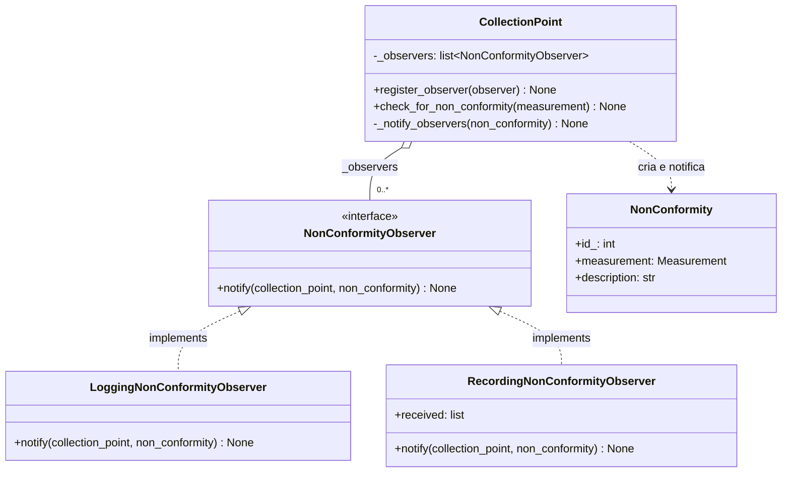
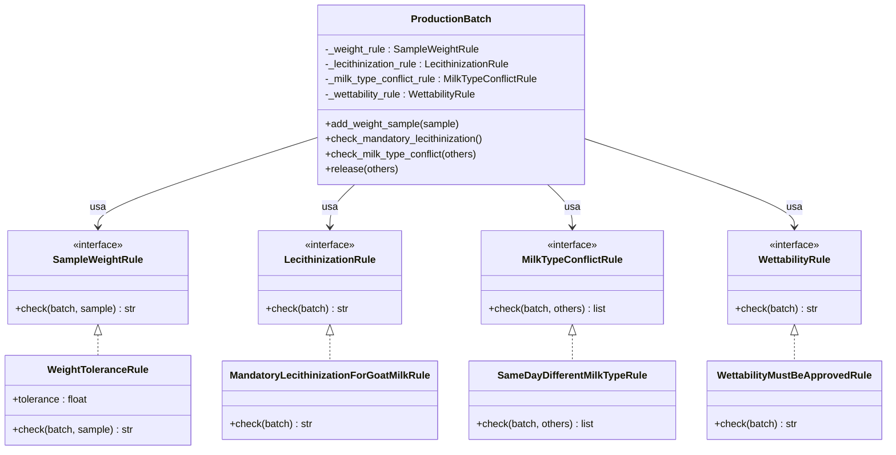

# Checkpoint 3 — Padrões GoF

**Disciplina:** Projeto de Software — UFF 2026.2
**Checkpoint:** 3 · Padrões GoF (10/11)
**Equipe:** Lucas Ardelino Alves da Silva, João Gabriel Pimentel, Aloysio Felipe Saad Silva, André Meschesi Dantas

Cada integrante implementa pelo menos um padrão GoF no seu agregado/módulo, introduzido
na Fase 2 (commits do próprio autor a partir de 06/10), resolvendo um problema real do
domínio — não um padrão que o framework já implementa. Os padrões são diferentes entre
si dentro do grupo.

| Integrante | Agregado/módulo | Padrão | Categoria | Status |
|---|---|---|---|---|
| João Gabriel Pimentel | `CollectionPoint` (domínio) | Observer | Comportamental | ✅ Concluído |
| Aloysio Felipe Saad Silva | _(preencher)_ | _(ex.: Strategy)_ | _(preencher)_ | ⬜ Pendente |
| Lucas Ardelino Alves da Silva | _(preencher)_ | _(ex.: State)_ | _(preencher)_ | ⬜ Pendente |
| André Meschesi Dantas | _(preencher)_ | _(ex.: Factory Method ou Decorator)_ | _(preencher)_ | ⬜ Pendente |

---

## João Gabriel Pimentel — Observer no agregado `CollectionPoint`

### Nome e categoria

**Observer** — padrão **comportamental**.

### Contexto no sistema e problema que ele resolve

`CollectionPoint.check_for_non_conformity` é o único lugar do sistema onde uma
`NonConformity` nasce (CQ-03 em `docs/arquitetura.md`: não existe repositório de
`NonConformity`, só a Aggregate Root escreve). Até este checkpoint, esse método
só fazia uma coisa com a não conformidade recém-criada: `self.non_conformities.append(...)`.
Nada fora do agregado era avisado.

Isso é uma lacuna real, já identificada antes deste checkpoint:

- `docs/arquitetura.md` §5.1 (alternativa C) registra explicitamente que "há um
  ponto onde eventos caberiam bem: a notificação de não conformidade para fora
  do agregado", deixado como caminho para a Fase 2.
- O stakeholder "Supervisor de produção" (§1 do mesmo documento) precisa saber
  quando algo sai da faixa — hoje só fica sabendo se consultar `GET
  /non-conformities` manualmente.

O problema de projeto, então, é: **como o `CollectionPoint` avisa um número
variável e crescente de interessados (log, auditoria, e-mail, fila de eventos)
sem conhecer nenhum deles e sem precisar ser alterado a cada novo
interessado?** Resolver isso com `if`/`else` dentro de
`check_for_non_conformity` reabriria a mesma violação de OCP corrigida no
Checkpoint 2 (`docs/solid.md`): a cada canal de notificação novo, o método do
agregado mudaria de novo.

### Por que esse padrão

**Observer** foi escolhido porque o problema é exatamente "um estado muda, N
partes precisam ser avisadas, e o número de partes varia com o tempo" — a
definição do padrão. O `CollectionPoint` (Subject) só depende de uma interface
(`NonConformityObserver`), nunca de um observador concreto.

Alternativas consideradas:

| Alternativa | Por que foi descartada |
|---|---|
| **Chamada direta no domínio** (ex.: `logging.warning(...)` dentro de `check_for_non_conformity`) | Acopla o domínio a um canal de notificação específico e viola CQ-01 (`domain/` não pode saber como o mundo externo é avisado) e reabre a violação de OCP do Checkpoint 2: um segundo canal (e-mail) exigiria editar `CollectionPoint` de novo. |
| **Lista de callables genéricos** (`list[Callable[[CollectionPoint, NonConformity], None]]`) em vez de uma interface | Resolveria o acoplamento, mas perde o contrato explícito que o projeto já usa para abstrações de borda (`AbstractCollectionPointRepository`, ADR-0002); uma interface nomeada (`NonConformityObserver`) deixa o papel de quem implementa óbvio e documentado, e é consistente com o estilo do resto do código. |
| **Arquitetura orientada a eventos entre agregados** (fila/barramento de eventos) | É a opção da Fase 2 "de verdade", mas tem custo de infraestrutura (fila, consistência eventual) que o projeto rejeitou em §5.1 para decisões não síncronas desse porte. Observer é o primeiro passo *dentro* do próprio processo — o mesmo ponto de extensão onde um publicador de eventos entraria depois. |

### Participantes mapeados para classes reais

| Papel no padrão | Classe real | Arquivo |
|---|---|---|
| **Observer** (interface) | `NonConformityObserver` | `src/LactoQC/domain/model.py` |
| **Subject / ConcreteSubject** | `CollectionPoint` | `src/LactoQC/domain/model.py` |
| **ConcreteObserver** (produção) | `LoggingNonConformityObserver` | `src/LactoQC/service_layer/notifications.py` |
| **ConcreteObserver** (teste) | `RecordingNonConformityObserver` | `tests/unit/test_collection_point.py` |
| Evento observado | `NonConformity` | `src/LactoQC/domain/model.py` |

`CollectionPoint.register_observer(observer)` anexa um `NonConformityObserver`
à lista interna `_observers`; `check_for_non_conformity` chama
`self._notify_observers(non_conformity)` logo após criar a não conformidade.
A rota `register_measurement` (`collection_point_routes.py`) e o caso de uso
`services.register_measurement` são quem registra o `LoggingNonConformityObserver`
no agregado antes de processar a medição — o Subject nunca instancia seu
próprio Observer.

### Diagrama de classes



### Teste que exercita o padrão

`tests/unit/test_collection_point.py`:

```python
def test_observer_is_notified_when_non_conformity_is_created():
    collection_point = make_collection_point()
    observer = RecordingNonConformityObserver()
    collection_point.register_observer(observer)

    day = date(2026, 9, 29)
    collection_point.add_measurement(make_measurement(1, MeasurementType.PH, day, 8.0))

    assert len(observer.received) == 1
    notified_point, notified_nc = observer.received[0]
    assert notified_point is collection_point
    assert notified_nc is collection_point.non_conformities[0]
```

Complementado por `test_observer_is_not_notified_when_measurement_is_within_specification`
(observer não é chamado quando não há não conformidade),
`test_multiple_observers_are_all_notified` (N observers independentes) e
`test_collection_point_without_observers_behaves_as_before` (regressão: sem
observers, o comportamento é idêntico ao de antes do padrão). No nível de
serviço, `tests/unit/test_collection_point_services.py::test_register_measurement_notifies_observers_of_new_non_conformities`
prova que o `observers` passado para `services.register_measurement` chega
de fato até o Subject.

Suíte completa depois da mudança: `180 passed` (era `174` antes deste
checkpoint — 6 testes novos, nenhum teste existente mudou de comportamento).

### Custo da aplicação do padrão

**Custo:** uma interface nova (`NonConformityObserver`), um módulo novo
(`service_layer/notifications.py`), dois métodos a mais em `CollectionPoint`
(`register_observer`, `_notify_observers`) e um parâmetro opcional
(`observers`) propagado por `services.register_measurement` e pela rota. É
indireção genuína: para saber o que acontece com uma não conformidade, agora
é preciso olhar em três arquivos em vez de um.

Há também um detalhe de borda que o padrão herdou do R-02 de
`docs/arquitetura.md` (SQLAlchemy não chama `__init__` ao carregar do banco):
`_observers` pode não existir em uma instância recarregada, por isso
`register_observer`/`_notify_observers` usam `getattr(self, "_observers", [])`
em vez de assumir que o atributo já existe. É um custo pequeno, mas que só
apareceu por causa do padrão.

**Por que compensa:** o canal de notificação atual (log) é deliberadamente o
mais simples possível — o ganho real é que adicionar um segundo canal (e-mail
ao supervisor, publicar em uma fila de eventos na Fase 2) é **uma classe nova
que implementa `NonConformityObserver` e uma linha em
`_non_conformity_observers`**, em `collection_point_routes.py`. Nenhuma
mudança em `CollectionPoint`, em `services.py` além da assinatura já pronta,
ou nos testes existentes. É exatamente o requisito que `docs/arquitetura.md`
§5.1 deixou em aberto, resolvido com o menor acoplamento possível.


## Aloysio Felipe Saad Silva — `ProductionBatch` (agregado Lote de Produção)

### Padrão GoF aplicado: Strategy (comportamental)


### Por que Strategy

As quatro regras de qualidade do Lote de Produção — tolerância de peso,
lecitinização obrigatória para leite de cabra, conflito de tipo de leite no
mesmo dia e aprovação da molhabilidade — são, cada uma, **um algoritmo de
decisão independente**: recebem o estado do lote (e, em dois casos, um dado
extra) e devolvem "passou" ou a descrição de uma violação. O padrão Strategy
existe exatamente para esse cenário: definir uma família de algoritmos,
encapsular cada um numa classe própria atrás de uma interface comum, e
tornar esses algoritmos intercambiáveis sem que a classe que os usa
(`ProductionBatch`) precise saber como cada um decide.

### Participantes do padrão, mapeados para o código

| Papel no padrão Strategy | Classe no código |
|---|---|
| Context (quem usa a estratégia) | `ProductionBatch` |
| Strategy (interface comum) | `SampleWeightRule`, `LecithinizationRule`, `MilkTypeConflictRule`, `WettabilityRule` |
| ConcreteStrategy (implementação) | `WeightToleranceRule`, `MandatoryLecithinizationForGoatMilkRule`, `SameDayDifferentMilkTypeRule`, `WettabilityMustBeApprovedRule` |

`ProductionBatch` recebe a estratégia desejada por injeção no construtor
(parâmetros opcionais `weight_rule`, `lecithinization_rule`,
`milk_type_conflict_rule`, `wettability_rule`), expõe cada uma por meio de
uma `@property` que cai para uma implementação padrão quando nenhuma foi
injetada, e delega a decisão a ela:

```python
@property
def weight_rule(self) -> SampleWeightRule:
    return getattr(self, "_weight_rule", self._default_weight_rule)

def add_weight_sample(self, weight_sample: WeightSample):
    self.weight_samples.append(weight_sample)
    violation = self.weight_rule.check(self, weight_sample)
    if violation:
        self._register_non_conformity(violation)
```

### Diagrama



### Como o teste comprova o padrão (e não só a regra de negócio)

A diferença entre "a regra funciona" e "o padrão Strategy está realmente
aplicado" é a **substituibilidade**: se eu trocar a implementação sem
modificar `ProductionBatch`, o comportamento do agregado muda de acordo.
Isso é o que `tests/unit/test_production_batch_strategy_pattern.py` testa
especificamente (separado dos testes de regra de negócio, que já existiam
em `tests/unit/test_production_batch.py`):

- `test_default_rule_instance_is_a_weight_tolerance_rule` — confirma que,
  sem nada injetado, o Context usa a ConcreteStrategy padrão.
- `test_injecting_a_stricter_weight_rule_changes_behavior` — cria uma
  `StrictWeightToleranceRule` (tolerância de 1%, escrita só para o teste,
  fora de `ProductionBatch`) e mostra que a **mesma amostra de peso**
  (104kg) passa com a estratégia padrão (5%) e gera não conformidade com a
  estratégia customizada — a decisão vem da estratégia, não de um `if`
  dentro do agregado.
- `test_injecting_a_permissive_wettability_rule_allows_release` — injeta
  uma `AlwaysApprovedWettabilityRule` e mostra que um lote com
  `wettability_result` ainda `PENDING` (que reprovaria com a regra padrão)
  é liberado — mesma prova, para a decisão de liberação do lote.
- `test_same_batch_class_supports_two_different_strategies_simultaneously` —
  dois lotes da mesma classe `ProductionBatch`, cada um com uma estratégia de
  peso diferente injetada, avaliando a mesma amostra com resultados opostos:
  evidencia que o algoritmo é propriedade da instância (via a estratégia
  injetada), não da classe.

Suíte completa de `tests/unit/`: **49 testes passando** (44 de regra de
negócio do agregado + 5 dedicados ao padrão Strategy).

---

## Lucas Ardelino Alves da Silva — _(preencher)_

- Nome e categoria:
- Contexto e problema:
- Por que esse padrão (com alternativa considerada):
- Participantes mapeados para classes reais:
- Diagrama de classes (Mermaid/PlantUML):
- Teste que exercita o padrão:
- Custo da aplicação:

---

## André Meschesi Dantas — _(preencher)_

- Nome e categoria:
- Contexto e problema:
- Por que esse padrão (com alternativa considerada):
- Participantes mapeados para classes reais:
- Diagrama de classes (Mermaid/PlantUML):
- Teste que exercita o padrão:
- Custo da aplicação:
